# Intently

**A minimal Android launcher built around intentions.**

Intently turns your home screen into a short list of intentions. Give each row a
word — Read, Listen, Create, Move — and group the apps that serve it underneath.
Tap the row to launch the primary app, or swipe up to open the whole intention.

Intently is an independent, GPLv3-licensed fork of
[Olauncher](https://github.com/tanujnotes/Olauncher) by Tanuj M.

## Features

- **Intention-first home screen.** Name each row (Read, Listen, Create, Move…), add the
  apps that serve it, and choose which app opens on a tap. With a single member a row
  behaves like a plain app; more members make it a folder you open with a swipe up.
- **App rename labels.** Give any app a bespoke name shown on the home screen and in
  the drawer.
- **Fast app drawer.** Search by name, with automatic launch when one result matches.
- **Useful gestures.** Swipe up for all apps, swipe up on an intention for its folder
  view, double tap to lock, and configurable left/right app shortcuts.
- **Home app slots.** Show 1–8 apps directly on the home screen.
- **Quiet by default.** No ads, no analytics, and no data collection.
- **Screen time.** Today's screen time at a glance, with a configurable app to open
  for details.
- **Make it yours.** Text size, bold font, alignment, themes, status bar, date/time
  display, and daily wallpapers.
- **Hidden apps.** Hide unused apps from the drawer; reveal them from settings.
- **Modern Android support.** Work profile and Private Space support on supported
  devices.
- **About page.** FAQs, tips, and the complete list of hidden niche features.

## Install

Download the latest APK from
[GitHub Releases](https://github.com/mexitalian/Intently/releases/latest).

Intently requires Android 7.0 (API 24) or newer. This fork is distributed through
GitHub Releases; it is not published on Google Play or F-Droid by this project.

## Navigation & gesture flow

```mermaid
flowchart TD
    Home["🏠 Home<br/>(Intention list)"]
    Drawer["📱 App Drawer<br/>(Search + all apps)"]
    Settings["⚙️ Settings"]
    Folder["📂 Expanded Folder View<br/>(inline on Home)"]
    ExtApp["📲 Launches external app"]
    SysAcc["🔒 System Accessibility Settings"]
    SysAppInfo["ℹ️ System App Info"]

    Home -->|"Swipe UP (anywhere)"| Drawer
    Home -->|"Long press"| Settings
    Home -->|"Double tap"| Lock["🔒 Lock screen<br/>(via accessibility service)"]
    Home -->|"Swipe LEFT / RIGHT"| Shortcut["📱 Shortcut app"]
    Home -->|"Tap intention row"| ExtApp
    Home -->|"Swipe UP on intention row"| Folder
    Home -->|"Long press intention row"| EditMode["✏️ Toggle edit mode<br/>(rename intention)"]
    Home -->|"Tap home app slot (1-8)"| ExtApp
    Home -->|"Long press home app slot"| RenameApp["✏️ Rename app label"]
    Home -->|"Tap clock"| ClockApp["🕐 Clock app"]
    Home -->|"Tap lock button"| ToggleLock["🔒 Toggle lock mode"]

    Folder -->|"Swipe DOWN / Tap outside"| Home
    Folder -->|"Long press intention name"| EditMode
    Folder -->|"Tap member app"| ExtApp
    Folder -->|"Long press member app"| RenameMember["✏️ Rename member"]

    Drawer -->|"Back / swipe down"| Home
    Drawer -->|"Settings icon"| Settings
    Drawer -->|"Tap app"| ExtApp
    Drawer -->|"Long press app"| ContextMenu["📋 Hide / Rename / Info"]
    ContextMenu -->|"App info"| SysAppInfo

    Settings -->|"Back"| Home
    Settings -->|"Set swipe shortcut"| Drawer
    Settings -->|"Hidden apps"| HiddenApps["👁️ Hidden apps list"]
    Settings -->|"About & FAQs"| About["📖 About page"]
    Settings -->|"Accessibility disclosure"| SysAcc
    Settings -->|"App info"| SysAppInfo

    classDef screen fill:#1a1a2e,stroke:#e94560,color:#fff
    classDef action fill:#0f3460,stroke:#533483,color:#fff

    class Home,Drawer,Settings,Folder screen
    class ExtApp,Lock,Shortcut,ClockApp,ToggleLock,EditMode,RenameApp,RenameMember,ContextMenu,HiddenApps,About,SysAcc,SysAppInfo action
```



| Gesture | Location | Action |
|---|---|---|
| Swipe up | Home (anywhere) | Open app drawer |
| Swipe up | Intention row | Open folder view |
| Swipe down | Folder view | Close folder view |
| Long press | Home screen | Open settings |
| Double tap | Home screen | Lock screen (accessibility) |
| Swipe left/right | Home screen | Open shortcut app |
| Tap | Intention row | Launch primary app |
| Long press | Intention row | Toggle edit mode (rename) |
| Tap | Home app slot | Launch app |
| Long press | Home app slot | Rename app label |
| Tap | Clock | Open clock app |
| Tap | Lock button | Toggle lock mode |
| Tap | App (in drawer) | Launch app |
| Long press | App (in drawer) | Hide / rename / info menu |

## Build

Intently is a standard Gradle Android project.

Requirements:

- JDK 17
- Android SDK with API 36 installed

```sh
./gradlew testDebugUnitTest
./gradlew assembleDebug
```

The debug APK is written to `app/build/outputs/apk/debug/`.

## Privacy

Intently does not include analytics, advertising, or crash-reporting SDKs. App
settings and intention data stay on the device. The optional daily wallpaper
feature downloads a wallpaper feed and image over HTTPS; no personal data is sent
with that request. The wallpaper feed is currently inherited from Olauncher.

The accessibility service is optional and is used only for the double-tap-to-lock
gesture. Usage-access data, when enabled, is processed on the device and is not
uploaded.

## Attribution and license

Intently is derived from [Olauncher](https://github.com/tanujnotes/Olauncher),
originally created by Tanuj M ([@tanujnotes](https://github.com/tanujnotes)) and
improved by its contributors. The original work is licensed under the GNU General
Public License v3.0. Original copyright remains with the Olauncher authors and
contributors; modifications in this fork are copyright their respective authors.

This project is distributed under the
[GNU General Public License v3.0](https://www.gnu.org/licenses/gpl-3.0.en.html).
See [LICENSE](LICENSE) for the full text.

Intently is not affiliated with or endorsed by the Olauncher project.
