# Navigation & Gesture Flow

> Reference diagram for Intently's screen navigation and touch/gesture interactions.
> This content is also embedded in the README.

## Screen navigation flow

```mermaid
flowchart TD
    Home["🏠 Home<br/>(Intention list)"]
    Drawer["📱 App Drawer<br/>(Search + all apps)"]
    Settings["⚙️ Settings"]
    Folder["📂 Expanded Folder View<br/>(inline on Home)"]
    ExtApp["📲 Launches external app"]
    SysAcc["🔒 System Accessibility Settings"]
    SysAppInfo["ℹ️ System App Info"]

    Home -->|"Swipe UP (anywhere)"| Drawer
    Home -->|"Long press"| Settings
    Home -->|"Double tap"| Lock["🔒 Lock screen<br/>(via accessibility service)"]
    Home -->|"Swipe LEFT / RIGHT"| Shortcut["📱 Shortcut app"]
    Home -->|"Tap intention row"| ExtApp
    Home -->|"Swipe UP on intention row"| Folder
    Home -->|"Long press intention row"| EditMode["✏️ Toggle edit mode<br/>(rename intention)"]
    Home -->|"Tap home app slot (1-8)"| ExtApp
    Home -->|"Long press home app slot"| RenameApp["✏️ Rename app label"]
    Home -->|"Tap clock"| ClockApp["🕐 Clock app"]
    Home -->|"Tap lock button"| ToggleLock["🔒 Toggle lock mode"]

    Folder -->|"Swipe DOWN / Tap outside"| Home
    Folder -->|"Long press intention name"| EditMode
    Folder -->|"Tap member app"| ExtApp
    Folder -->|"Long press member app"| RenameMember["✏️ Rename member"]

    Drawer -->|"Back / swipe down"| Home
    Drawer -->|"Settings icon"| Settings
    Drawer -->|"Tap app"| ExtApp
    Drawer -->|"Long press app"| ContextMenu["📋 Hide / Rename / Info"]
    ContextMenu -->|"App info"| SysAppInfo

    Settings -->|"Back"| Home
    Settings -->|"Set swipe shortcut"| Drawer
    Settings -->|"Hidden apps"| HiddenApps["👁️ Hidden apps list"]
    Settings -->|"About & FAQs"| About["📖 About page"]
    Settings -->|"Accessibility disclosure"| SysAcc
    Settings -->|"App info"| SysAppInfo

    classDef screen fill:#1a1a2e,stroke:#e94560,color:#fff
    classDef action fill:#0f3460,stroke:#533483,color:#fff

    class Home,Drawer,Settings,Folder screen
    class ExtApp,Lock,Shortcut,ClockApp,ToggleLock,EditMode,RenameApp,RenameMember,ContextMenu,HiddenApps,About,SysAcc,SysAppInfo action
```

## Gesture reference

| Gesture | Location | Action |
|---|---|---|
| Swipe up | Home (anywhere) | Open app drawer |
| Swipe up | Intention row | Open folder view |
| Swipe down | Folder view | Close folder view |
| Long press | Home screen | Open settings |
| Double tap | Home screen | Lock screen (accessibility) |
| Swipe left/right | Home screen | Open shortcut app |
| Tap | Intention row | Launch primary app |
| Long press | Intention row | Toggle edit mode (rename) |
| Tap | Home app slot | Launch app |
| Long press | Home app slot | Rename app label |
| Tap | Clock | Open clock app |
| Tap | Lock button | Toggle lock mode |
| Tap | App (in drawer) | Launch app |
| Long press | App (in drawer) | Hide / rename / info menu |

## Screens

1. **Home** — Intention list (main screen). Shows intention rows, home app slots, clock, lock button.
2. **App Drawer** — All apps with search. Auto-launches when single match.
3. **Settings** — Full settings page (themes, text size, alignment, gestures, wallpapers, about, etc.).
4. **Expanded Folder View** — Inline overlay when swiping up on an intention. Shows all member apps. Not a separate screen.
5. **About page** — FAQs, tips, hidden niche features list.

## External interactions

- **Launch app** — Tapping any app/row launches the external app (leaves Intently).
- **Lock screen** — Double tap uses the accessibility service to lock the device.
- **System settings** — Accessibility disclosure opens system accessibility settings; app info opens system app info.
- **Clock** — Opens the device's clock app.